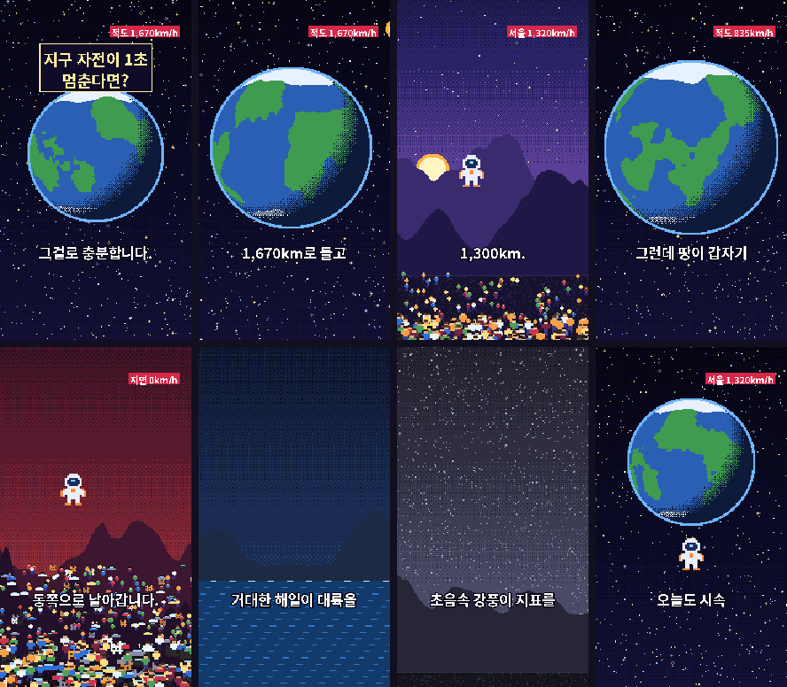

# IF 60 Studio

**"만약 ~라면?" 과학 상상 쇼츠를 도트 애니메이션으로 만드는 제작 도구** (프로토타입 v0.1)

장면 구성 YAML 하나로 9:16 · 1080×1920 · 최대 60초 쇼츠를 렌더링합니다.
AI가 만든 이미지·영상을 '도트풍'이 아닌 **진짜 도트**로 바꾸는 후처리가 핵심입니다.


*예제 `examples/earth_rotation_stop.yaml` — API 키 없이 렌더링한 결과*

## 할 수 있는 것

| 기능 | 설명 |
|---|---|
| **도트 후처리** | 9:16 크롭 → 저해상도 축소 → 팔레트 양자화(+Bayer 디더) → 정수배 확대. 픽셀 격자가 정확히 맞음 |
| **AI 영상 안정화** | 프레임 간 미세 노이즈 무시(hold) + 색 경계 히스테리시스로 AI 영상의 지글거림 제거 |
| **레이어 패럴랙스** | 배경·중경·전경을 다른 속도로 움직이는 '하이브리드 카메라 효과'. AI 영상 비용 0원 |
| **절차적 레이어** | 별, 자전하는 행성, 산맥, 바다, 태양, 마스코트를 코드로 생성 → 키 없이 전 과정 테스트 |
| **군중 레이어** | 사람·고양이·강아지·자동차 미니 스프라이트 수백~수천 개를 원근감 있게 배치·이동 ('시뮬레이션' 느낌, AI 비용 0원) |
| **시계·카운터 HUD** | `05:00 → 23:30`, `1,670 → 0km/h`, `+1년` 같은 진행 배지 — 끝까지 보게 만드는 장치 |
| **도트 한글 자막** | 내레이션처럼 2~5단어씩 끊어 보여주는 자막(기본), 타이틀 카드, 타자기 효과 |
| **칩튠 BGM·효과음** | 분위기(wonder/tense/calm/epic)별 8비트 음악을 코드로 생성 → 저작권 걱정 없음 |
| **효과** | 흔들림(+폭발음), 플래시, 경보 틴트, 디더 페이드 인/아웃 |
| **장면 초안 생성** | 주제 → 장면 YAML 초안 (Claude API, 선택) |

### 안정화 효과 (시뮬레이션 측정값)

AI 영상처럼 노이즈가 낀 클립을 180×320 도트로 바꿨을 때 **프레임마다 색이 바뀌는 픽셀 비율**:

| 장면 | 후처리 없음 | 안정화 적용 |
|---|---|---|
| 정지 장면 | 20.2% | **1.2%** |
| 느린 패닝 | 45.1% | 30.4% (남은 변화는 대부분 실제 움직임) |

## 설치

```bash
# 1) ffmpeg 설치
brew install ffmpeg            # macOS
winget install ffmpeg          # Windows

# 2) 파이썬 패키지 (Python 3.10+)
python -m venv .venv && source .venv/bin/activate   # Windows: .venv\Scripts\activate
pip install -r requirements.txt

# 3) (권장) 갈무리체를 fonts/ 폴더에 넣기 — fonts/README.md 참고
```

## 사용법

```bash
# 예제 렌더링 (빠른 미리보기 → 최종본)
python -m if60 render examples/earth_rotation_stop.yaml --preview
python -m if60 render examples/earth_rotation_stop.yaml --stills out/stills

# 스타일·길이 바꾸기 (UI의 '영상 스타일', '영상 길이' 옵션)
python -m if60 render examples/earth_rotation_stop.yaml --style retro_dot --length 30
python -m if60 render examples/earth_rotation_stop.yaml --length 120   # 2분짜리로 늘리기

# AI로 만든 이미지/영상 하나만 도트로 후처리
python -m if60 pixelate kling_clip.mp4 -o out/clip_dot.mp4 --style retro_dot
python -m if60 pixelate midjourney.png -o out/still_dot.png

# 주제로 장면 초안 만들기 (ANTHROPIC_API_KEY 필요) → 사람이 검토 후 render
python -m if60 plan "달이 사라진다면?" -o scenes/moon.yaml

python -m if60 styles
```

결과물은 `out/`에 저장됩니다.

## 장면 YAML 구조

```yaml
title: 지구의 자전이 1초 동안 멈춘다면?
style: cinematic_pixel            # config/styles.yaml 의 프리셋
music: {mood: tense, bpm: 118, seed: 60}
scenes:
  - duration: 7
    title: 지구 자전이 1초 멈춘다면?   # 상단 타이틀 카드 (선택)
    caption: 그런데 땅이 갑자기 멈춘다면?
    typewriter: true
    layers:                          # 아래에서 위 순서로 쌓임
      - {kind: starfield}                          # 절차적 레이어
      - {kind: planet, params: {spin: 0}}          # spin 0 = 자전 정지
      - {source: ai, prompt: "a lone astronaut on a cliff", speed: 0.6}
      - {source: image, path: assets/city.png, speed: 0.3}
      - {source: video, path: clips/tsunami.mp4}   # AI 영상 클립 → 자동 도트 후처리
      - {kind: crowd, params: {mix: {cat: 0.8, person: 0.2}, count: 1200, top: 0.6, vx: 20}}
    hud: {from: "05:00", to: "06:30"}           # 또는 hud: "+1년" / {from: 1670, to: 0, format: "{:,.0f}km/h"}
    camera: {pan: [40, 0], fade_in: 0.35, fade_out: 0.35}
    effects:
      - flash: {at: 1.5, length: 0.17}
      - shake: {at: 1.5, length: 1.6, amp: 5}
```

- `speed`: 카메라 이동에 대한 패럴랙스 배율 (0 = 고정, 1 = 카메라와 같이 이동)
- `camera.pan`: 장면 동안 이동할 거리 (저해상도 픽셀 단위, 부드럽게 가감속)
- 절차적 `kind`: `sky`, `starfield`, `planet`, `sun`, `mountains`, `ground`, `ocean`, `mascot`, `crowd`
- 자막: 기본은 `caption`을 2~5단어 덩어리로 자동 분할. 직접 나누려면 `captions: [..]`, 문장 통째로는 `caption_mode: full`
- `crowd` 옵션: `agent`(person/cat/dog/car) 또는 `mix`, `count`, `top`/`bottom`(세로 범위), `vx`(흐르는 속도), `grid`(0~1, 줄 맞춘 대열)

## 스타일 프리셋

| 프리셋 | 원본 해상도 | 배율 | fps | 팔레트 |
|---|---|---|---|---|
| `cinematic_pixel` 시네마틱 픽셀아트 | 180×320 | ×6 | 12 | 이미지별 자동 32색 (강조색 보존) |
| `retro_dot` 레트로 도트 | 135×240 | ×8 | 10 | 고정 16색 + 디더링 |

`config/styles.yaml`에서 해상도, 팔레트, 플리커 억제 강도(`hold`)를 조정할 수 있습니다.

## AI 생성 API 연결

| 종류 | 현재 상태 | 설정 |
|---|---|---|
| 이미지 | `mock`(기본, 키 불필요) / `openai` | `IF60_IMAGE_PROVIDER=openai`, `OPENAI_API_KEY`, `IF60_IMAGE_MODEL` |
| 영상 | 외부에서 생성한 클립을 `source: video`로 넣기 | Kling·Veo 등 API 직접 호출은 다음 단계 |
| 대본 | Claude API 초안 | `ANTHROPIC_API_KEY`, `IF60_PLANNER_MODEL` |

> ⚠️ `openai` 이미지 제공자와 `plan` 명령은 실제 키로 아직 검증하지 않았습니다. 첫 호출 결과를 확인해 주세요.
> 같은 프롬프트는 `.cache/ai/`에 캐시되어 다시 비용이 들지 않습니다.

새 제공자는 `if60/providers.py`의 `ImageProvider`를 상속해 `generate()`만 구현하면 됩니다.

## 구조

```
if60/
  pixelate.py    도트 후처리 · 자동 팔레트 · AI 영상 시간축 안정화
  procedural.py  절차적 레이어 (행성, 별, 산맥, 바다, 마스코트)
  render.py      장면 합성 · 패럴랙스 · 효과 · 렌더 파이프라인
  text.py        도트 한글 자막
  chiptune.py    칩튠 BGM · 효과음
  providers.py   AI 이미지 생성 연결부 (+캐시)
  planner.py     주제 → 장면 YAML 초안
  media.py       ffmpeg 입출력
config/styles.yaml   스타일 프리셋
examples/            예제 장면
```

## 운영 시 주의

YouTube는 템플릿으로 찍어낸 듯 영상 간 차이가 거의 없는 대량 생산 콘텐츠를 수익 창출에서 제외합니다.
이 도구는 **제작 노동을 자동화**하는 용도로 쓰고, 편마다 관점·대본·연출은 사람이 직접 다듬는 것을 권장합니다.
`plan` 명령이 완성본이 아닌 **초안**과 `facts_to_check` 목록을 내놓는 것도 그 때문입니다.

## 로드맵

- [x] 군중 레이어, 시계·카운터 HUD, 끊어 읽는 자막
- [ ] 웹 UI (주제 / 스타일 / 길이 / 애니메이션 방식 선택 화면)
- [ ] 한국어 TTS 내레이션 + 음성 기반 자막 타이밍
- [ ] Kling / Veo 영상 API 직접 호출 + 비용 표시
- [ ] 장면별 재생성, 캐릭터 레퍼런스 시트로 일관성 유지
- [ ] YouTube 예약 업로드 · 시청 지속률 피드백

## 라이선스

MIT. 폰트·외부 AI 생성물의 라이선스는 각 제공처 약관을 따릅니다.
