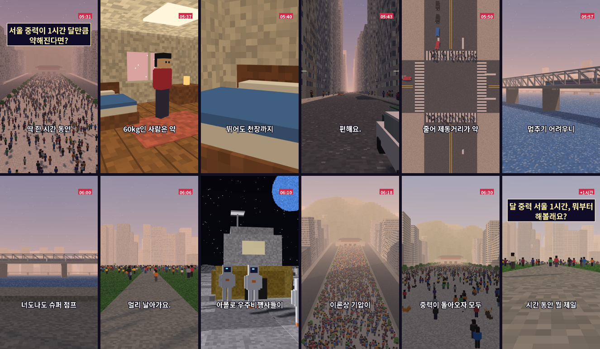
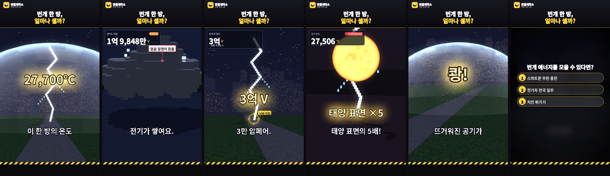
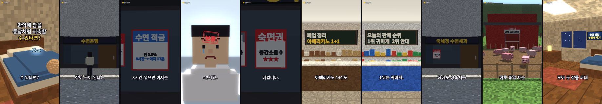

# IF 60 Studio

**"만약 ~라면?" 상상 쇼츠를 3D 복셀 애니메이션으로 만드는 제작 도구** (v0.4 — 방송형 연출)

장면 구성 YAML 하나로 9:16 · 1080×1920 · 30fps 쇼츠를 렌더링합니다.
블록으로 지은 3D 도시에 수천 명의 군중을 세우고, 시계 HUD에 맞춰 새벽→낮→밤으로 하늘이 바뀌며, 2~5단어씩 끊어 읽는 자막이 올라갑니다.
AI 영상 생성 크레딧 없이 컴퓨터에서 직접 렌더링하므로 편당 추가 비용이 거의 없습니다.
자막을 **AI 목소리가 읽고, 장면·자막·연출이 목소리 길이에 자동으로 맞춰집니다** (배경음악은 없음 — 음악은 업로드할 때 앱에서).


*예제 `examples/seoul_moon_gravity.yaml` — "서울 중력이 1시간 동안 달처럼 약해진다면?" (1분 51초, 18장면)*

---

## ⚡ 가장 쉬운 사용법: 주제만 입력하기

1. 저장소 폴더에서 **`IF60 만들기.command`** 를 더블클릭 (Windows는 `IF60 만들기.bat`)
2. 터미널 창에 주제를 입력하고 Enter — 예: `파리는 어떻게 그렇게 잘 도망칠까?`
3. 기다리면 끝: **웹 조사 → 대본·연출 작성 → 감독 검수(장면 미리보기를 보고 화면·자막 불일치 장면 수정) → 렌더링 → 영상 자동 재생**
   (조사·작성 1~3분 + 렌더링 수 분)

- **대본 작성에 Claude가 필요해요. Pro/Max 구독이 있으면 추가 비용 없이 쓸 수 있어요 (추천).**
  처음 한 번만 Claude Code를 설치하고 로그인하세요:
  ```bash
  curl -fsSL https://claude.ai/install.sh | bash     # Windows PowerShell: irm https://claude.ai/install.ps1 | iex
  # 새 터미널 창을 열고
  claude                                             # 브라우저가 열리면 Pro 계정으로 로그인 → /exit 로 종료
  ```
  이후 `make`는 Claude Code를 통해 **구독 사용량**으로 조사·대본을 작성합니다. (Pro는 5시간마다 사용량이 초기화돼요)
- 구독 대신 API로 쓰고 싶으면 `python -m if60 key`로 API 키를 저장하세요 (사용량만큼 별도 과금, 편당 대략 수백 원 추정).
  둘 다 있으면 Claude Code(구독)를 먼저 씁니다. `.env`에 `IF60_BACKEND=api`를 넣으면 API로 고정돼요.
- 완성되면 터미널에 **확인할 사실 목록과 출처**가 나옵니다. 올리기 전에 꼭 확인하세요.
- Mac에서 "확인되지 않은 개발자" 경고가 뜨면: 파일을 우클릭 → 열기 → 열기.

터미널에서 직접 하려면:
```bash
python -m if60 make "파리는 어떻게 그렇게 잘 도망칠까?"            # 1080×1920 완성본
python -m if60 make "파리는 어떻게 그렇게 잘 도망칠까?" --preview  # 빠른 저화질 확인
python -m if60 make "주제" --length 60                               # 길이 지정 (기본: 방송형 90초 · 결과 사다리 110초)
python -m if60 make "만약에 비가 탄산수로 내린다면?" --format ladder  # 대본 형식 지정 (auto | broadcast | ladder)
```

### 🎙 내레이션 목소리
목소리를 **먼저** 만들고, 그 길이에 맞춰 장면 길이·자막 넘김·연출(번쩍임, 큰 글자, 카운터…) 시각을 자동으로 맞춥니다. 캡컷에서 싱크를 맞출 필요가 없어요.

| 목소리 | 비용 | 준비 | 주의 |
|---|---|---|---|
| `supertonic:M1` 등 (**기본**) | 무료·무제한 (내 컴퓨터에서 생성) | 없음 (처음 한 번 모델 자동 다운로드) | AI 음성임을 설명란에 밝히기 (문구 자동 생성) |
| `typecast:tc_…` | 무료 플랜 월 15,000자 (쇼츠 30~40편) | [타입캐스트 API 콘솔](https://studio.typecast.ai/developers/api)에서 키 발급 → `python -m if60 key typecast` | 무료 플랜은 **상업적 이용 불가 + 출처 표기 필수** (문구 자동 생성) |
| `google:Charon` 등 | 월 100만 자 무료 | 구글 Cloud에서 Text-to-Speech API 키 발급(결제 계정 등록 필요) → `python -m if60 key google` | 무료 한도를 넘으면 과금 |

```bash
python -m if60 voice list supertonic           # 목소리 목록 (typecast / google도 가능)
python -m if60 voice test supertonic:F3        # 들어보기 (out/voice_test_…wav 재생)
python -m if60 voice use supertonic:F3         # 기본 목소리로 정하기 → 이후 make가 이 목소리로
python -m if60 make "주제" --voice typecast:tc_xxxx   # 이번 영상만 다른 목소리
python -m if60 make "주제" --no-voice                  # 무음으로
```
- 완성되면 `out/` 에 영상과 함께 **목소리만 담은 `_voice.wav`**, 설명란에 붙일 **`_출처표기.txt`** 가 생깁니다.
- 같은 문장은 저장해 두었다가 재사용하므로, 다시 렌더링해도 타입캐스트·구글 사용량이 늘지 않아요.
- 숫자·기호를 다르게 읽히고 싶으면 장면에 `narration:`을 쓰면 됩니다. 예: `caption: 약 27,700℃` / `narration: 약 이만 칠천 도`
- 장면 파일 맨 위에 `voice: typecast:tc_xxxx` 를 쓰면 그 영상만 해당 목소리로, `voice: false`면 무음입니다.

### 만든 영상은 어디에?
저장소 폴더 안의 **`out`** 폴더에 쌓입니다. 장면 파일(대본)은 **`scenes`** 폴더에 저장돼요.
```bash
open out        # Mac: Finder로 out 폴더 열기 (Windows: explorer out)
```

---

## 1. 설치 (처음 한 번)

**필요한 것:** Python 3.10 이상, ffmpeg

### macOS
```bash
brew install python ffmpeg          # Homebrew가 없으면 https://brew.sh 먼저 설치
git clone https://github.com/yongjujun/if60-studio.git
cd if60-studio
python3 -m venv .venv
source .venv/bin/activate
pip install -r requirements.txt
```

### Windows (PowerShell)
```powershell
winget install Python.Python.3.12
winget install Gyan.FFmpeg
git clone https://github.com/yongjujun/if60-studio.git
cd if60-studio
py -m venv .venv
.venv\Scripts\activate
pip install -r requirements.txt
```
설치 후 PowerShell을 새로 열어야 `ffmpeg` 명령이 인식됩니다.

### 설치 확인
```bash
python -m if60 styles     # 스타일 목록이 나오면 성공
```

> 비공개 저장소라 `git clone` 할 때 GitHub 로그인을 요구할 수 있어요. 브라우저 로그인 창이 뜨면 로그인하면 됩니다.

---

## 2. 영상 만들기

`.venv`를 켠 상태(`source .venv/bin/activate` 또는 `.venv\Scripts\activate`)에서 실행합니다.

```bash
# ① 빠른 미리보기 (360×640, 15fps) — 구성과 타이밍 확인용
python -m if60 render examples/seoul_moon_gravity.yaml --preview

# ② 최종본 (1080×1920, 30fps) — 업로드용
python -m if60 render examples/seoul_moon_gravity.yaml

# 장면별 대표 프레임을 PNG로도 저장 (썸네일 고를 때)
python -m if60 render examples/seoul_moon_gravity.yaml --stills out/stills

# 길이 맞추기 (모든 장면 길이를 비례 조정)
python -m if60 render examples/seoul_moon_gravity.yaml --length 60
```
결과물은 `out/` 폴더에 저장됩니다.

**렌더링 시간 참고** (1분 51초 예제 기준)
| 환경 | 미리보기 | 최종본 |
|---|---|---|
| GPU 없는 서버 (CPU 소프트웨어 렌더링) | 약 5분 | 약 30분 |
| 일반 노트북/데스크톱 GPU (Apple Silicon, 내장/외장 그래픽) | 1분 내외 | 수 분 (예상) |

---

## 3. 새 회차 만들기

1. `examples/seoul_moon_gravity.yaml`을 복사해 `scenes/새주제.yaml`로 저장
2. 장면마다 `caption`(대본), `world`(장소), `shot`(카메라), `crowds`(군중)를 고치기
3. `--preview`로 확인 → 최종본 렌더링

### 장면 하나의 구조
```yaml
- duration: 6                           # 초
  caption: 새벽 5시 30분 광화문 광장. 중력이 6분의 1로 줄었어요.   # 2~5단어씩 자동으로 끊겨 나옴
  title: 서울 중력이 1시간 달만큼 약해진다면?                       # (선택) 상단 제목 상자
  hud: {from: "05:32", to: "05:35", step: 1}   # 우측 상단 시계. 하늘·조명도 이 시각을 따라감
  world: {template: plaza, seed: 3}           # 장소 템플릿
  shot: forward                               # 템플릿이 제공하는 카메라 샷
  crowds:                                     # 군중 (여러 개 가능)
    - {agent: person, count: 1800, area: plaza, facing: 0, bob: 0.9, bob_freq: 1.8}
    - {agent: cat, count: 300, area: plaza, bob: 1.2, scale: [1.6, 2.0]}
  effects:                                    # (선택) 연출 효과
    - shake: {at: 1.0, length: 1.4, amp: 5}
```

### 방송형 연출 (만물제작소 스타일)
`make`로 만든 영상은 기본으로 이 구조를 씁니다. 예시: `scenes/lightning_power.yaml` ("번개 한 방, 얼마나 셀까?")



**영상 전체 설정 (맨 위)**
```yaml
layout:                                  # 상단: 채널(만물제작소) + 시리즈 + 두 줄 제목(흰색/노란색), 하단: 경고 줄무늬
  title: ["번개 한 방,", "얼마나 셀까?"]
  series: 만물 실험 1편                   # (선택)
look: voxel                              # voxel(픽셀 복셀, 기본) | smooth(매끈한 질감 + 부드러운 색감)
bloom: 0.45                              # 빛 번짐 세기 (0이면 끔) — 불빛·번개·불티만 번지고 밝은 배경은 번지지 않음
```
**장면에 쓰는 것**
```yaml
panel:                                   # 데이터 대시보드 (왼쪽 위): 숫자가 0부터 굴러 올라감
  title: 번개 한 줄기
  value: {from: 0, to: 300000000, format: kr, unit: V}   # kr → "3억", 큰 차이는 자동 로그 스케일
  stats: ["전류 약 3만 A"]
  bars: [{label: 번개, from: 0, to: 1, color: red, text: 3억 V}]
  status: ×0.001 슬로모션                 # 깜빡이는 상태 배지
big_text: [{text: "3억 V", from: 2.4, pos: [0.5, 0.56]}]   # 크고 빛나는 글자 (팝업 등장)
markers: [{at: [0, 0.5, 60], from: 1.1, text: 낙뢰 지점}]   # 3D 지점의 빛나는 표적 링
vfx:                                     # 3D 특수효과
  - {type: shockwave, at: [0, 0, 60], from: 0.4, to: 2.4, radius: [0, 45]}   # 반투명 충격파 돔
  - {type: fireball, at: [0, 1, 0], from: 0.5, to: 4, radius: [0.05, 0.4]}   # 커지는 불덩이
  - {type: mushroom, at: [0, 0, 170], from: 0.2, to: 4.5, radius: 22, height: 60}   # 버섯구름
  - {type: orb, at: [0, 10, 100], radius: [6, 8], color: "#7fdcff"}           # 반투명 빛 구
  - {type: embers, at: [0, 0, 60], radius: 10, height: 18, count: 260}        # 솟아오르는 불티
props:
  - {model: bolt, at: [0, 0, 60], scale: 3.2, grow: {from: 0.3, to: 0.4}}    # grow: 그 시간에 커지며 나타남
effects:
  - whiteout: {at: 2.2, length: 0.8, hold: true}   # 하얗게 날아감 (hold: 끝까지 유지)
  - rewind: {at: 0, length: 1.1}                   # 되감기 화면 (◀◀ 되감기)
card:                                    # 마무리 카드 (world 없이도 됨 — 앞 장면을 흐리게 깔아 줌)
  question: 번개 에너지를 모을 수 있다면?
  options: [스마트폰 무한 충전, 전기차 전국 일주, 치킨 튀기기]
  cta: 댓글로 번호를 남겨주세요
```
**구성 공식 (대본 작성 AI가 따르는 규칙)**
1. **콜드 오픈** — 1번 장면(2~3초)에 가장 센 순간을 먼저: 큰 숫자 + VFX + 하얗게 날아감
2. **되감기** — 2번 장면을 `rewind`로 시작해 "처음부터 볼게요"
3. **본편** — 숫자는 대시보드 카운터로, 핵심 수치는 빛나는 큰 글자로, 지점은 표적 링으로
4. **반전 비교** 한 번 → **마무리 카드**로 댓글 유도

**만물제작소 제작 조건** — 대본이 나오면 자동으로 검사하고, 어긋나면 최대 두 번 다듬습니다.
- 첫 3초 안에 호기심을 자극하는 훅
- 60~120초 안에 **도입 → 전개 → 반전 → 결말** 완성 (장면마다 `act:` 표시)
- **AI 이미지 6~10장**으로도 시각화 가능: 최상위 `keyframes`에 그림 목록, 장면은 `image: 번호`로 가리킴.
  영상이 완성되면 `out/…_AI이미지.txt`에 이미지 생성기에 붙여넣을 프롬프트가 저장됩니다.
- 장르별 톤 (`genre:`): 사회 풍자(`satire`)는 **통쾌하게**, 과학(`science`)은 **흥미롭게**, 황당한 가정(`absurd`)은 **진지하게**

**웃음 설계: 1절 → 2절 → 3절(삼천포) → 복귀** — 정보를 한 번 말하고 끝내지 않고, 결과의 결과로 꼬리를 물어 엉뚱한 곳까지 갔다가 정색하고 돌아옵니다.
- `tangent: 1` 직접 결과 → `tangent: 2` 엉뚱한 부작용 → `tangent: 3` 삼천포 → `role: snapback` "…아무튼." 하고 복귀 → 반전
- 장면 절반 이상에 웃음 장치(`gag:` 정색 반전·숫자 개그·삼천포·콜백 등)를 3종류 이상
- 대본이 완성되면 **개그 작가 다듬기**가 대사의 펀치라인을 한 번 더 세게 만듭니다 (짧은 지시문이라 사용량이 적고, 숫자·사실은 바꾸지 않음). 끄려면 `--no-punchup`

**주제 목록으로 바로 만들기** — `topics.yaml`에 주제·장르·방향 힌트가 저장돼 있어요.
```bash
python -m if60 topics        # 목록 보기
python -m if60 make 4        # 4번 주제로 제작
python -m if60 make 1-3      # 1~3번을 차례로 (1,5,9 / 전체 도 가능)
```
`IF60 만들기` 파일을 더블클릭하면 목록이 먼저 보이고, 번호나 새 주제를 입력하면 됩니다.

**시청 유지 설계 (3초 훅 · 20초 반전 · 기억에 남는 끝)** — 시청자가 빠져나가는 세 지점을 장면에 `role`로 표시합니다.
| role | 위치 | 역할 |
|---|---|---|
| `hook` | 1번 장면, 3초 안 (대사 20자 안팎) | 결과를 먼저 던지고 이유를 숨겨 스크롤을 멈춤 |
| `twist` | 시작 후 15~30초 | 지금까지의 예상을 한 번 뒤집어 중간 이탈을 막음 |
| `payoff` | 마무리 카드 바로 앞 | 기억에 남는 한 줄, 가능하면 첫 장면 콜백(반복 재생 유도) |

대본이 나오면 자동으로 이 구조를 검사하고, 어긋나면 한 번 다듬습니다(사실·수치는 그대로). 다듬은 안이 더 나쁘면 원래 대본을 씁니다.

### 결과 사다리 형식 (`--format ladder`) — 상상 하나를 생활 곳곳에
"만약에 ~라면?" 규칙 하나만 바꾸고, 그 결과가 **침실 → 출근길 → 회사 → 은행 → 병원 → 부동산 → 가게 → … → 삼천포(농장·세무서)** 순으로
생활 영역 곳곳에서 터지는 걸 **2.5~4초 컷 20~34개(약 2분)**로 이어 붙이는 형식입니다. 각 컷이 독립된 작은 개그라 끝까지 보게 돼요.
예시: `scenes/sleep_bank.yaml` ("만약에 잠을 저축할 수 있다면?")



- **화면 틀:** `layout: {style: simple, title: "만약에 …?"}` — 화면 전체가 3D, 첫 4초만 가운데에 큰 질문(마지막 줄 노란색), 채널명은 왼쪽 위에 작게
- **간판 개그(3D 속 글자):** 웃음의 절반이 간판·현수막·가격표·매물 카드에서 나옵니다. 카메라가 움직여도 원근이 생겨요.
  ```yaml
  props:
    - {shape: sign, style: card, title: "숙면권", text: "층간소음 0\n**★★★**", size: [0.75, 0.95], at: [-1.0, 1.2, -0.01]}
    - {shape: sign, style: banner, text: "단체 낮잠장 · 성수기 할증 30%", size: [11.6, 1.2], at: [0, 1.4, 13.9], color: "#2f6fd6"}
  ```
  style: `board`(안내판) `card`(매물 카드·전단) `banner`(현수막) `shop`(가게 간판) `price`(가격표 칠판) `screen`(TV·모니터, 빛남) `neon`(빛남) `paper`(종이)
  · `**글자**`는 강조색 줄 · `mount: pole|stand`(기둥·다리) · `grow`로 '쾅' 등장
- **얼굴 클로즈업:** `{model: bust, yaw: 180}` + `shot: face` — 표정 `bust`(정색) `bust_surprised` `bust_happy` `bust_sad` `bust_smug`, 긴 머리는 `bust_long…`
- **생활 세트 7종:** `office` `elevator` `shop`(kind: snack 분식집 · butcher 정육점 · store 편의점 · cafe) `shopfront`(가게·부동산 외관) `clinic`(병원 대기실) `pool`(워터파크) `farm`(농장, `pig`·`chicken`)
- **대본 규칙:** 장면마다 `domain:`(생활 영역) — 서로 다른 곳 8곳 이상 · 간판 장면 4개 이상 · 1절(개인) → 2절(가게·회사·돈) → 3절(삼천포) → "…아무튼." 복귀 → 반전 → 첫 장면 콜백 → 양자택일 질문 + "답은 다음 영상에서"
- `topics.yaml`의 4·5·7·12~15번은 `format: ladder`로 지정돼 있어요. 형식을 안 정하면(`auto`) 작가가 주제를 보고 고릅니다.

### 블랙코미디·풍자 톤 (기본)
대본은 **정색한 다큐 톤으로 사실을 짚고, 그 사실이 만드는 부조리에 피식 웃게** 쓰도록 되어 있습니다. 기본 길이는 **약 90초, 3막**
(①콜드 오픈+사실 ②상상 전개 — 황당함이 점점 커짐 ③찬반 양쪽+현실 확인+질문 카드). 예시: `scenes/juvenile_law_abolished.yaml`
- 풍자의 과녁은 제도·관료주의·모순. 피해자·약자·실존 인물은 조롱하지 않고, 의견이 갈리는 주제는 양쪽을 고르게 다룹니다.
- 상상 장면은 `가상 상황` 자막띠로 표시해 실제 사실과 섞이지 않게 합니다.

```yaml
big_text: [{text: "기각", style: stamp, from: 2.0, angle: -8}]       # 빨간 도장이 쾅
chyron: [{tag: 가상 상황, text: "정부, 촉법소년 제도 전면 폐지", from: 0.6}]   # 뉴스 하단 자막띠 (속보 / 가상 상황 / 실제 상황)
effects:
  - punch: {at: 3.4, length: 2.0, zoom: 1.3}                         # 순간 줌인 후 정지 (어이없는 순간)
beat: 0.8                                                            # 대사 끝나고 0.8초 정적 — 펀치라인 뒤 웃을 틈
```

### 사물·원리를 직접 보여주기 (자유 주제)
과자 봉지, 분자, 음식, 물건처럼 **장소가 아닌 대상**은 `studio`(단색 무대)나 `tabletop`(식탁 위) 세트에 소품을 놓고,
움직이는 입자는 군중으로, 이름표는 라벨로 붙입니다. 예시: `scenes/nitrogen_snack.yaml`
```yaml
- duration: 5
  visual: 앞면이 잘린 과자 봉지 단면 — 안에서 파란 질소 분자들이 떠다님   # 화면에 보일 것 (대본 작성용 메모)
  caption: 봉지 안을 채운 건 대부분 질소 기체예요.
  world: {template: studio, params: {color: "#f1e6d2"}}
  shot: close
  props:                                   # 정지한 사물
    - {model: snack_bag_cut, at: [0, 0, 0], scale: 3, color: "#d8443a"}
    - {shape: sphere, r: 0.2, at: [0.8, 0.5, 0], color: "#e0473f"}   # 목록에 없으면 도형으로 직접
  crowds:                                  # 여러 개 / 떠다니는 입자
    - {agent: molecule_n2, count: 16, area: [-0.3, -0.12, 0.3, 0.05], y_range: [0.3, 1.0], wander: 0.12, spin: 1.5, scale: 0.55}
  labels:                                  # 3D 위치에 붙는 이름표 (카메라가 움직여도 따라감)
    - {text: "질소 N2", at: [0, 0.7, -0.05], from: 1.0}
```
- 소품 모델: `snack_bag` `snack_bag_cut`(단면) `chip` `molecule_n2` `molecule_o2` `molecule_co2` `molecule_h2o` `bottle` `cup` `phone` `book` `parcel` `rocket` `coin` `lightbulb` `flame` `cloud` `ball` `germ` `table` `bolt`(번개) `spark`(빛 입자) (+ 사람·동물·차 등 군중 모델 모두)
- 도형: `{shape: box, size: [w,h,d]}` `{shape: sphere, r}` `{shape: cylinder, r, h}` + `color`, `mat: flat|stone|glass|glow`
- 입자 움직임: `wander`(제각각 떠다님), `y_range`(공중 높이 범위), `spin`(회전), `velocity: [vx, vy, vz]`, `wrap: false`(밖으로 빠져나감)

### 장소 템플릿과 샷
| 템플릿 | 장소 | 샷 (`shot:`) | 군중 구역 (`area:`) |
|---|---|---|---|
| `studio` | 단색 무대 (`params: {color: "#hex"}`) — 사물·원리 설명용 | `front` `close` `wide` `orbit` `top` | `stage` `air` `back` |
| `tabletop` | 방 안 식탁 위 (상판 높이 0.9m) — 일상 사물 클로즈업 | `table` `close` `low` `orbit` `top` | `table`(높이 자동) `floor` |
| `plaza` | 넓은 광장 + 도로 + 빌딩 + 성문 + 뒷산 | `forward` `aerial` `low` `rise` `gate` | `plaza` `road_l` `road_r` `sidewalk_l` `sidewalk_r` |
| `boulevard` | 고층 빌딩 협곡 사이 대로 | `forward` `sidewalk` `canyon` `up` | `road` `sidewalk_l` `sidewalk_r` |
| `crossroad` | 위에서 본 교차로 + 횡단보도 | `top` `top_drift` `street` | `lane_s` `lane_n` `lane_e` `lane_w` `crosswalk_n/s/e/w` `corner_ne/nw/se/sw` |
| `river_bridge` | 강 + 트러스 철교 + 건너편 도시 | `side` `along` `aerial` `bank` | `track_1` `track_2` `bank` `deck` |
| `apartments` | 아파트 단지 | `aerial` `low` `rise` | `lawn` `path` |
| `room` | 방 안 (침대·책상·창문) | `inside` `close` | `floor` `bed` |
| `field` | 넓은 잔디밭 + 먼 스카이라인 | `forward` `low` `aerial` | `field` `near` `path` |
| `planet` | 화성/달 표면 + 착륙선 (`params: {surface: moon}`) | `forward` `aerial` `lander` | `surface` `near_lander` `front_of_lander` |
| `office` | 사무실 (책상·모니터, 뒷벽 간판 자리) | `wide` `desk` `aisle` `face` | `desks` `aisle` `front` |
| `elevator` | 복도에서 본 엘리베이터 칸 (문 위 층수 화면) | `front` `inside` `doors` | `cabin` `hall` |
| `shop` | 가게 안 (`params: {kind: snack/butcher/store/cafe}`) | `counter` `queue` `close` `face` | `queue` `floor` `staff` |
| `shopfront` | 길가 가게·부동산 외관 (유리창 + 간판 띠) | `front` `window` `street` | `sidewalk` `queue` `road` |
| `clinic` | 병원·피부과 대기실 | `reception` `waiting` `face` | `seats`(앉은 높이) `floor` `staff` |
| `pool` | 워터파크 (물·데크·선베드·미끄럼틀) | `deck` `aerial` `poolside` | `water`(물에 잠김) `deck` `loungers` |
| `farm` | 농장 (울타리 우리·헛간) | `pen` `wide` `low` | `pen` `yard` |

`area`에는 구역 이름 대신 `[x0, z0, x1, z1]` 좌표를 줄 수도 있습니다.

### 군중 옵션
| 옵션 | 뜻 | 예 |
|---|---|---|
| `agent` | `person` `cat` `dog` `car` `train` `astronaut` `tree` `bed` | `cat` |
| `count` | 개수 (수천 개도 빠름) | `3000` |
| `layout` | `random` / `grid`(줄 맞춤) / `queue`(한 줄, `axis: x`로 가로) | `queue` |
| `facing` | `random` / 각도 / `[x, z]`(그 지점을 봄) / `velocity` | `180` |
| `velocity` | 이동 속도 m/s `[vx, vz]`, 구역 안에서 순환 | `[0, 1.8]` |
| `bob`, `bob_freq` | 들썩임·점프 높이(m)와 빠르기 | `1.2`, `2.0` |
| `scale` | 크기 배율 (멀리서도 보이게) | `[1.6, 2.0]` |
| `colors`, `colors2` | 색 팔레트 직접 지정 | `["#e8913a"]` |
| `y` | 높이 고정 (철교 위 열차 등) | `15` |

카메라가 지나가는 길 위의 군중은 자동으로 비켜서 렌즈를 가리지 않습니다.

### 조명 시각
- `hud`가 시계면(`"05:00"` 형식) 하늘·햇빛·안개·창문 불빛이 자동으로 그 시각을 따라갑니다. 새벽은 분홍, 낮은 파랑, 노을, 밤에는 별과 창문 불빛이 켜져요.
- 직접 정하려면 `time: "21:30"` 또는 `time: {from: "18:00", to: "19:30"}`을 씁니다.
- `world: {template: planet, params: {surface: moon}}`은 검은 우주 하늘에 지구가 떠 있고, `surface: mars`는 황토색 하늘입니다.

### 카메라 직접 지정
```yaml
shot: {from: [0, 7, -30], to: [0, 7, 40], target: [0, 5, 220], fov: 55}     # 이동 촬영
shot: {type: orbit, center: [0, 1, 41], radius: 17, height: 3, from_deg: 150, to_deg: 195}
shot: {type: topdown, center: [0, 0, 0], height: 90, height_to: 75}
```
좌표는 미터 단위이고 x는 오른쪽, y는 위, z는 앞쪽입니다.

---

## 4. 그 밖의 기능

| 기능 | 명령 / 설정 |
|---|---|
| 2D 도트 스타일 (이전 방식) | `style: cinematic_pixel` 또는 `retro_dot` — `examples/earth_rotation_stop.yaml` |
| AI 이미지·영상 도트 후처리 | `python -m if60 pixelate 입력.mp4 -o out/결과.mp4` |
| 주제 → 영상 한 번에 | `python -m if60 make "주제"` (위 '가장 쉬운 사용법') |
| 주제로 장면 파일만 만들기 | `python -m if60 plan "주제" -o scenes/초안.yaml` |
| 효과 | `shake`(카메라 흔들림) `flash` `tint` `whiteout` `rewind` `punch`(줌인) / `camera: {fade_in: 0.5, fade_out: 0.8}` |

### API 키 (선택 — Claude Code를 쓰면 필요 없음)
키는 **절대 YAML이나 코드에 적지 말고** 환경변수로만 넣으세요. `.env` 파일은 `.gitignore`로 저장소에서 제외됩니다.
```bash
python -m if60 key                # Anthropic 키 저장/변경 (make·plan용, .env에 저장)
export OPENAI_API_KEY=...         # AI 이미지 레이어 (2D 스타일)
```
대본 작성 모델은 기본 `claude-sonnet-5-5`이고, `.env`에 `IF60_PLANNER_MODEL=claude-opus-5-5`를 넣으면 더 높은 품질(비용 약 2배)로 바꿀 수 있어요.

---

## 5. 구조

```
if60/
  voxel/
    renderer.py   3D 렌더러 (그림자, MSAA, 하늘, 군중 인스턴싱, VFX 돔·불덩이·버섯구름, 자라나는 소품)
    templates.py  장소 템플릿 17종 (생활 세트 포함) + 샷 + 군중 구역
    models.py     블록 모델 (사람, 동물, 사물, 얼굴 클로즈업 bust 표정 5종 …)
    signs.py      3D 속 글자 소품 (간판·현수막·가격표·매물 카드·화면)
    shaders.py    픽셀 질감 재질, 밤에 켜지는 창문, 물결, 픽셀 해·별
    sky.py        시간대별 하늘·조명
    camera.py     카메라 경로 (이동, 궤도, 부감)
    geometry.py   상자 기반 지오메트리
  render.py      장면 → 영상 파이프라인 (자막, HUD, 효과, 내레이션 싱크)
  tts.py         내레이션 목소리 (Supertonic·타입캐스트·구글) + 캐시
  overlay.py     방송형 화면: 레이아웃, 대시보드, 빛나는 글자, 표적 링, 마무리 카드, 빛 번짐, 전환 효과
  text.py        자막·HUD 배지
  pixelate.py    2D 도트 후처리
config/styles.yaml   스타일 프리셋 (voxel, cinematic_pixel, retro_dot)
examples/            예제 장면
```

## 6. 운영 시 주의

- **사실 확인:** 예제 YAML 맨 위의 `facts_to_check`처럼, 대본의 수치는 올리기 전에 반드시 확인하세요.
- **수익 정책:** YouTube는 템플릿으로 찍어낸 듯 차이 없는 대량 생산 콘텐츠를 수익 창출에서 제외합니다. 도구는 제작 노동을 줄이는 데 쓰고, 편마다 주제·관점·연출은 직접 다듬으세요.

## 로드맵
- [x] 3D 복셀 렌더러, 장소 템플릿 8종, 시간대 조명, 군중 인스턴싱
- [x] 시계·카운터 HUD, 끊어 읽는 자막
- [x] 방송형 연출: 고정 레이아웃, 대시보드 카운터, 빛 번짐, 충격파·불덩이·불티 VFX, 빛나는 큰 글자, 마무리 카드, 콜드 오픈
- [x] 한국어 TTS 내레이션 + 목소리 길이에 맞춘 장면·자막·연출 자동 싱크
- [ ] 걷기 애니메이션(다리 움직임), 군중 모이기·흩어지기 동작
- [x] 주제 입력 → 웹 조사 → 대본·장면 자동 생성 → 렌더링 (`make`, 더블클릭 실행)
- [x] 결과 사다리 형식: 3D 속 글자 소품, 생활 세트 7종, 얼굴 클로즈업 표정, 심플 틀
- [ ] 커버(썸네일) 템플릿 자동 생성

## 라이선스
MIT. 폰트·외부 AI 생성물의 라이선스는 각 제공처 약관을 따릅니다.
